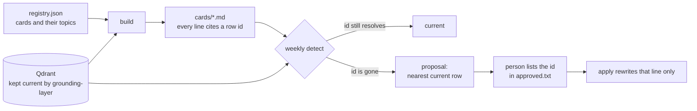

# field-systems

**Field cards built from your sources, and a weekly check that proposes a fix when a source changes.**

A card that quotes the docs is right on the day it ships. This kit builds each card line from a row
in the index and prints the row's id beside it. When the source later changes that sentence, the id
stops resolving, the check finds the line, and a person approves the replacement before anything is
rewritten.

Built on [field-kit](https://github.com/meinsta/field-kit). Reads the collection that
[grounding-layer](https://github.com/meinsta/grounding-layer) keeps current.

## Get started

```bash
git clone https://github.com/meinsta/field-systems && cd field-systems
pip install -r requirements.txt
python3 test_offline.py                          # no cluster, no keys

export QDRANT_URL=... QDRANT_API_KEY=...         # the cluster grounding-layer refreshed
python3 -m fieldsys.card                         # registry.json -> cards/*.md
python3 -m fieldsys.keep_current --detect        # -> review/digest.md
```

## The loop



| Step | What it guarantees |
|---|---|
| Build | A card writes no new facts. Each topic gets the best docs row and the best field row, with their ids. Customers appear by segment and vertical. |
| Detect | A cited id that no longer resolves is drift. The proposal is the nearest current row from the same source, or removal when nothing current says it. |
| Approve | Nothing is rewritten until a person lists the proposal id in `review/approved.txt`. |
| Apply | Only approved lines change. A second apply is a no-op. |

## What we found

Run on a Qdrant Cloud cluster over the Quillfeather fixtures. The docs changed one sentence: the old
key keeps working for 48 hours, not 24. After the next grounding refresh:

```
## 9381a670 in cards/security-review.md
Why: the cited source line was retired
Now:      - Docs: Rotate a key from the console or with the rotate endpoint, and the old key keeps working for 24 hours.
Proposed: - Docs: Rotate a key from the console or with the rotate endpoint, and the old key keeps working for 48 hours.
```

| Check | Result |
|---|---|
| Lines current before the change | All 10 across 2 cards |
| Drift detected after the change | 1 of 1 |
| Applied before approval | Nothing |
| Applied after approval | The one line; the next detect reports all current |

One card line is weaker than the rest. For "How do we verify a webhook is really from Quillfeather?"
the build picked the sentence about delivery retries, where the signature sentence is the answer. That is the
same question grounding-layer's recall gate misses at k=3: a card is only as good as the retrieval under it.

## Not here yet

Decks, the liveness check (a named proof customer is no longer a customer), and outreach drafts for
account owners.

## Make it yours

Edit [`registry.json`](registry.json): one entry per card, with the questions it answers. To add a
lane beyond docs and field notes, extend `line()` and `build()` in [`fieldsys/card.py`](fieldsys/card.py).
