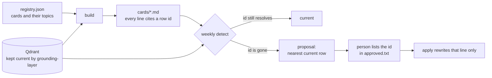

# field-systems

**Build field cards from your sources and get a proposed fix each week a source changes.**

On the day a card ships, every line on it matches the docs. Then the docs move the key overlap
from 24 hours to 48, and the card keeps saying 24 on every call until someone notices.

This kit builds each card line from a row in the index and prints the row's id beside it. When a
source changes that sentence, the id stops resolving. The weekly check finds the line and proposes
the current sentence, and a person approves the replacement before the card changes.

Built on [field-kit](https://github.com/meinsta/field-kit). Reads the collection that
[grounding-layer](https://github.com/meinsta/grounding-layer) keeps current.

## Run It on the Sample Company

```bash
git clone https://github.com/meinsta/field-systems && cd field-systems
pip install -r requirements.txt
python3 test_offline.py                          # runs offline

export QDRANT_URL=... QDRANT_API_KEY=...         # the cluster grounding-layer refreshed
python3 -m fieldsys.card                         # registry.json -> cards/*.md
python3 -m fieldsys.keep_current --detect        # -> review/digest.md
```

## Keep Every Card Line Current



The loop has four steps, and this table gives each step's guarantee.

| Step | Guarantee |
|---|---|
| Build | Every fact on a card is a row from the index. Each topic gets its best docs row and its best field row, with their ids, and customers appear by segment and vertical. |
| Detect | A cited id that has stopped resolving is drift. The proposal is the nearest current row from the same source, or removal when the source has dropped the point. |
| Approve | A person lists the proposal id in `review/approved.txt`. The card stays as it is until then. |
| Apply | Approved lines change and every other line stays. A second apply leaves the card as it is. |

## See the Results Measured on a Live Cluster

On a Qdrant Cloud cluster with the Quillfeather fixtures, the docs changed a sentence: the old key
keeps working for 48 hours, where it used to say 24. After the next grounding refresh, the check
wrote this:

```
## 9381a670 in cards/security-review.md
Why: the cited source line was retired
Now:      - Docs: Rotate a key from the console or with the rotate endpoint, and the old key keeps working for 24 hours.
Proposed: - Docs: Rotate a key from the console or with the rotate endpoint, and the old key keeps working for 48 hours.
```

This table sums up the run.

| Check | Result |
|---|---|
| Lines current before the change | All 10, across both cards |
| Drift detected after the change | The 1 line that cited the old sentence |
| Lines changed before approval | 0 |
| Lines changed after approval | 1, and the next detect reported every line current |

Read the webhook topic on the security card with care. For "How do we verify a webhook is really
from Quillfeather?" the build picked the sentence about delivery retries, where the signature
sentence is the answer. grounding-layer's recall gate misses the same question at k=3, which shows
that a card is as good as the retrieval under it.

## See What This Kit Adds Next

Decks, a check that named proof customers are still customers, and outreach drafts for account
owners.

## Point It at Your Own Cards

Edit [`registry.json`](registry.json): add an entry per card, with the questions it answers. To
add a lane beyond docs and field notes, extend `line()` and `build()` in
[`fieldsys/card.py`](fieldsys/card.py).
